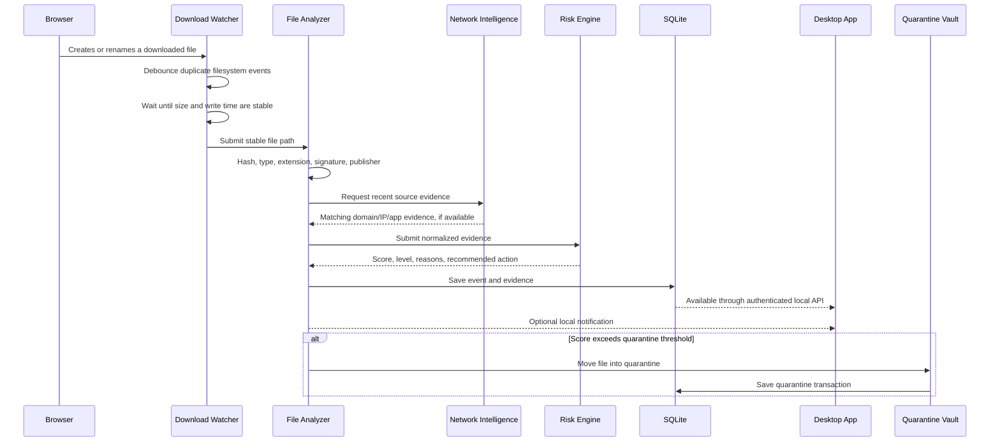

# 2. End-to-End Operation

## Complete event flow

## Stage 1 — Watching directories

The service watches an explicit set of directories, initially the current user's Downloads folder. Additional directories can be added later.

Windows produces noisy filesystem events. One browser download may generate create, change, rename, and close operations. The watcher therefore does not analyze every event immediately. It creates a pending record keyed by normalized full path and applies a debounce period.

Temporary download names must be ignored or treated as incomplete, including common patterns such as:

- `.crdownload`
- `.part`
- `.partial`
- `.tmp`
- browser-generated random temporary names

## Stage 2 — Stability check

A file is considered ready only when:

- it still exists;
- it is not a directory or reparse-point escape;
- its size and last-write timestamp remain unchanged across multiple checks;
- it can be opened for reading with appropriate file sharing;
- it is not still using a known partial-download extension.

If stability is not reached before the timeout, the event remains `incomplete` and can be retried. It must not be labeled malicious merely because the browser is still writing it.

## Stage 3 — Identity collection

The analyzer records:

- normalized path and filename;
- byte size;
- creation and modification time;
- SHA-256 hash;
- declared extension;
- basic file type inferred from header bytes;
- mismatch between extension and detected type;
- Windows Mark-of-the-Web information when present;
- Authenticode status;
- signer subject and certificate thumbprint;
- archive summary, when safely supported;
- whether the same hash or filename was previously observed.

## Stage 4 — Source correlation

Filesystem monitoring usually cannot prove the original URL. Correlation is therefore represented with a confidence level:

- **Exact:** browser extension reports the download identifier and URL.
- **Strong:** browser process, timestamp, hostname, and destination align closely.
- **Possible:** a relevant domain was contacted near the download time.
- **Unknown:** no reliable source evidence exists.

The system must never present a guessed source as a confirmed fact.

## Stage 5 — Risk decision

The risk engine receives normalized facts, not raw UI strings. It produces:

- numeric score from 0 to 100;
- level: Low, Review, High, or Critical;
- list of positive and negative score contributions;
- recommended action;
- policy action actually applied.

## Stage 6 — Action

Possible actions are:

- Log only.
- Notify the user.
- Require confirmation before trust.
- Quarantine automatically.
- Delete only after explicit user confirmation.

The first release should favor logging and quarantine over automatic permanent deletion.

## Stage 7 — Continuous integrity

If the user restores or trusts a file, its hash is stored. When that path changes later, it is reanalyzed. Trust applies to a precise identity, not merely to a filename.

