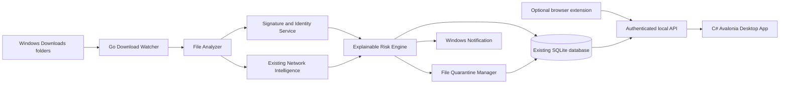

# 3. Technical Architecture

## Proposed components



## Why the Go service owns security logic

The Go service already owns filtering, APIs, the database, connection intelligence, and persistent security state. Keeping download analysis there provides:

- one source of truth;
- persistence when the desktop window is closed;
- centralized audit logging;
- reusable APIs for the desktop app and future interfaces;
- clearer privilege boundaries.

The C# Avalonia application should render state, request actions, and display notifications. It should not independently calculate a conflicting risk score.

## Proposed Go package layout

```text
internal/downloadguard/
  manager.go            orchestration and lifecycle
  watcher_windows.go    directory events and stability checks
  analyzer.go           hashing, type checks, name analysis
  signature_windows.go  Authenticode evidence
  risk.go               deterministic scoring
  quarantine.go         isolation, restore, and delete
  models.go             API-safe models
  manager_test.go
  risk_test.go
```

## Service lifecycle

1. Database opens.
2. Download Guardian loads settings and unfinished operations.
3. Quarantine consistency is verified.
4. Configured directories are validated.
5. Watchers start.
6. Pending events enter a bounded work queue.
7. A small worker pool analyzes stable files.
8. Shutdown cancels watchers and completes or safely abandons active transactions.

## Concurrency rules

- Use a bounded queue so a large extraction cannot consume unlimited memory.
- Deduplicate work by normalized path plus file identity.
- Limit hashing concurrency to reduce disk pressure.
- Perform database writes in short transactions.
- Never hold a database transaction while hashing a large file.
- Cancellation must leave the original file untouched unless a quarantine transaction already committed.

## Security boundary

The local API remains authenticated. Mutating operations—settings, trust, restore, delete, and quarantine—are protected by the existing configuration vault. Read-only event and analytics endpoints can remain available after normal login.

## Browser extension role

The extension is optional. Its purpose is metadata accuracy, not file scanning. It may send:

- download ID;
- original and final URL;
- suggested filename;
- MIME type reported by the server;
- start and completion timestamps;
- browser identity.

It must not send page contents, form values, passwords, cookies, or the downloaded file itself.

