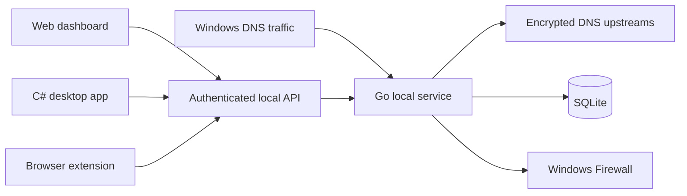

# Architecture, Data, and API

## Runtime architecture

## Go service responsibilities

- DNS server and upstream exchange.
- Policy evaluation and cache.
- Windows DNS routing operations.
- Firewall application rules and schedules.
- Connection and destination intelligence.
- Download watcher and quarantine.
- Vault, audit, and security packs.
- Local HTTP API and dashboard assets.
- Productivity persistence.

## SQLite

Uses WAL mode, busy timeout, and normal synchronous behavior to reduce blocking between DNS writes and dashboard reads. Feature managers create their own tables when initialized.

## API security

- Page routes redirect unauthenticated users to login.
- API routes return unauthorized errors.
- Mutating security paths additionally require an unlocked configuration vault.
- Public extension analysis uses a narrowly scoped endpoint and explicit CORS handling.

## Important API families

- `/api/stats`, `/api/recent`, `/api/stream`
- `/api/filtering`, `/api/system/dns`, `/api/protection`
- `/api/categories`, `/api/keywords`, `/api/apps`
- `/api/app-network`, `/api/network-intelligence`
- `/api/network-profiles`, `/api/dns-route-watch`
- `/api/downloads`
- `/api/vault`, `/api/security-packs`
- `/api/organizer`, `/api/discipline`

## Windows privileges

Administrator privileges are required for DNS adapter changes, privileged listening ports, and Windows Firewall rules. Read-only dashboard operations do not require a new privilege prompt once the service is running.

## Privacy

DNS logs, connection metadata, productivity data, file hashes, signatures, and paths are stored locally. External list downloads and configured DNS upstreams still communicate with their respective providers. No feature should claim total anonymity.

## Shutdown and recovery

The main process shuts down the DNS server, API server, connection-freeze backend, download watcher, filter engine, and database in a controlled order. Persistent firewall states and quarantine records are reconciled by their managers.

